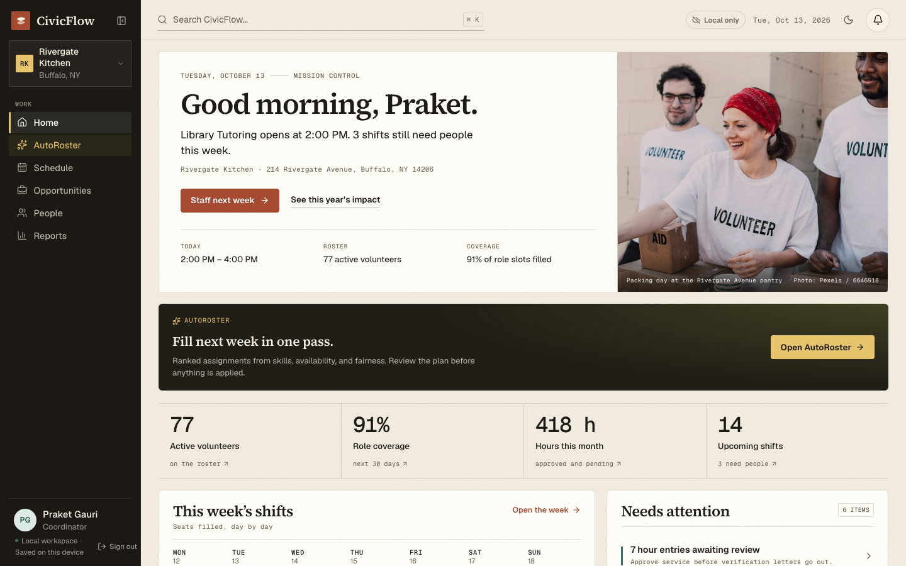
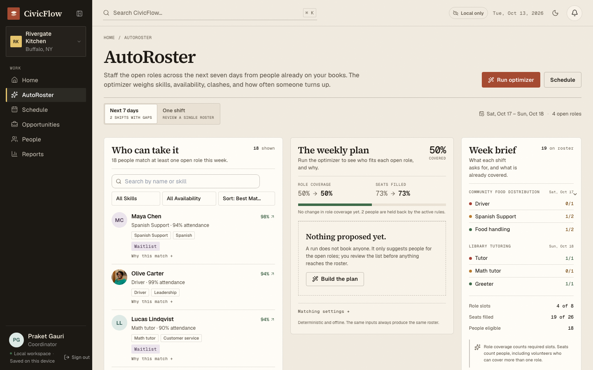
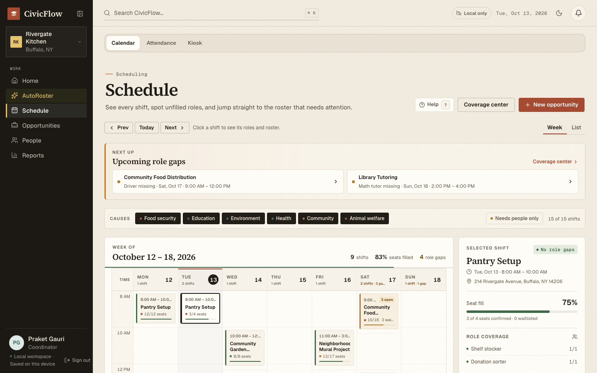
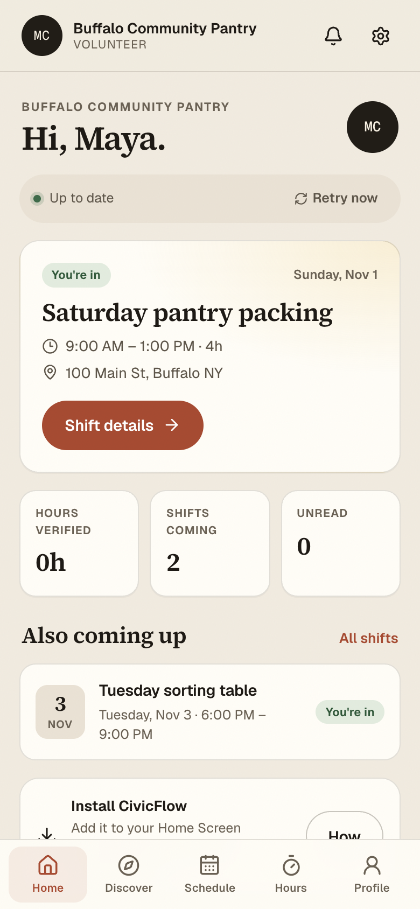
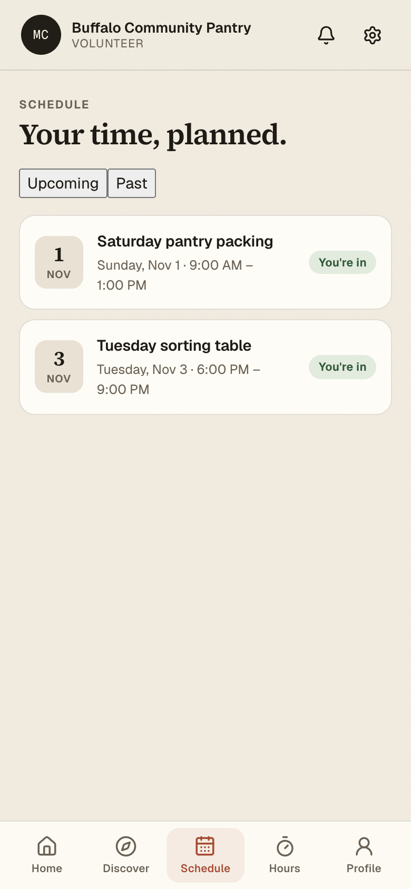

# CivicFlow

CivicFlow is a volunteer coordination app for small nonprofits. Coordinators plan shifts,
staff open roles, run the check-in desk, review hours, and report outcomes. Volunteers find
service, register, check in, and keep a record of what they contributed.

The desktop app runs on a local SQLite database. Scheduling, reporting, check-in, and
AutoRoster work without a network connection. Accounts and organization membership are
enforced by the Rust core, not by hiding screens in the browser.

The volunteer PWA is a separate entry point backed by Supabase. It keeps a small replica,
queues writes, and reconciles through a command log. The hosted workspace is the authority
for anything shared across devices. The desktop can open that same hosted workspace in its own
window — one replica, the same command authority — while keeping its local SQLite workspace one
click away. Deployment and the remaining gaps are covered in **Cloud workspace** below.

<!-- CIVICFLOW_FACTS_START -->
| Fact | Value |
| --- | --- |
| Package version | `0.1.1` |
| Registered routes | 57 |
| Migration files | 15 |
| Database schema | v15 |
| Application tables | 51 |
<!-- CIVICFLOW_FACTS_END -->

## What it looks like



*Home answers what needs attention now: the next shift, coverage for the week, and one queue
for hours waiting on review, applications, coverage gaps, and expiring credentials.*

| AutoRoster | Schedule |
| --- | --- |
|  |  |
| A plan for the week, with the reason for every assignment. | The calendar, the roster, and the check-in kiosk. |

| Volunteer home | Volunteer schedule |
| --- | --- |
|  |  |
| The installable PWA, working from its offline replica. | Registration, waitlist, and shift detail. |

The two volunteer screenshots use the hosted test organization. The desktop demo is the
separate Rivergate Kitchen workspace described below.

## Try it in five minutes

1. `pnpm install && pnpm dev`, then open `http://localhost:5173`.
2. Choose **Open demo workspace**. It signs into the seeded Rivergate Kitchen organization on this
   device, with no account and no network.
3. **Home** shows what needs attention. Open **AutoRoster**, build the week, read the evidence
   for an assignment, and apply the plan.
4. **Schedule**, open a shift, then **Kiosk** to show a check-in code and record attendance.
5. The volunteer side is `http://localhost:5173/pwa.html`. It needs `VITE_SUPABASE_ANON_KEY` to
   reach the hosted project; the volunteer screenshots above come from that workspace.

## Demo and judging

Setup for the presentation is local and needs no network: `pnpm install && pnpm dev`, then **Open
demo workspace**. The seven-minute route through the product:

| Time | Screen | What to show | What it proves |
| --- | --- | --- | --- |
| 0:00 | Home | The attention queue, next shift, weekly coverage | The app starts from what needs a decision, not a dashboard of totals |
| 0:45 | AutoRoster | Build the week, open **Why this person?** and **Why not?** | A min-cost max-flow plan with an explanation for every assignment |
| 2:15 | Schedule | Open a shift, show the roster, launch the kiosk | One place for the calendar, staffing, and check-in |
| 3:15 | People → Hours | Approve or reject a pending hour entry | Rules live in the core, and the decision is recorded in the audit log |
| 4:15 | Reports | Pick a range, **Preview**, then **Print / save PDF** | The report reads every row, and the PDF matches the page breaks on screen |
| 5:30 | Shared workspace | `/shared/reports` or `/shared/schedule` | The same organization across devices, with an offline outbox and a conflict center |
| 6:30 | Help | `Cmd/Ctrl+K`, then `?` | Navigation and instructions are built into the product |

If the venue has no network, stop after Reports. Every coordinator screen except the shared
workspace runs on the local SQLite copy.

How the rating sheet maps to the build:

| Rating-sheet item | Where it lives | What to point at |
| --- | --- | --- |
| Coding language selection | Why this stack, above; `src-tauri/core`; `src/types` | Rust domain core plus typed TypeScript at the boundary |
| Comments, naming, formatting | ESLint, Prettier, `cargo fmt`, `cargo clippy`; module headers in `src/lib/sync/sharedReports.ts` and `src/features/shared/FunderPacketPreview.tsx` | Comments explain why a rule exists; CI fails on formatting and lint |
| Modular, logical, readable | The repository boundary, `src/lib/workspace/selectors.ts`, pure report math, `src/lib/csv.ts` | Screens do not keep private copies of records; shared behavior has one home |
| UX design, user journey, accessibility | Product and Accessibility, above; `src/app/AppShell.tsx`; `src/components/ui` | Six coordinator areas, five volunteer areas, keyboard palette, focus styles, `jest-axe` and browser audits |
| Intuitive interface, clear instructions | First-run tour, inline form help, the help dialog | A new coordinator can publish a shift and check someone in without a manual |
| Help menu and intelligent feature | `src/lib/help/topics.ts`, `src/lib/ask/answers.ts`, AutoRoster explanations | Searchable per-screen help, Ask CivicFlow answers from the workspace, and every match explained |
| Input validation | Rust validation in `src-tauri/core`; field errors in `src/components/ui/Form.tsx` | A bad email, a shift that ends before it starts, and a stale row version each get a specific message |
| Addresses the prompt | Programs, recruitment, scheduling, participation, hours, credentials, records, reports | The run of show touches each part of volunteer management |
| Customizable, presentable reports | `/reports`, `/reports/custom`, `/shared/reports` | Date range, report library, CSV export, and a Letter-size funder packet with a checked page count |
| Data storage and scope | SQLite migrations, Postgres migrations, `src/types/domain.ts` | Relational constraints in the database, arrays and maps on screen, no global mutable state |

Questions judges ask:

**Why not a web-only app?** A volunteer desk often has unreliable Wi-Fi. The local core keeps
scheduling, check-in, hours, and reports working with the network down; the shared workspace is
an explicit second mode, not a requirement.

**Where is authorization enforced?** In Rust, behind the UI. Every command resolves the session
token and checks membership and role before reading or writing. The browser preview is demo data
and never ships in the desktop build.

**What happens when two devices edit the same row?** Each write carries the row version it read.
The server refuses a stale version and the conflict center shows both values instead of merging
them silently.

**What would you build next?** Native mobile check-in, richer funder templates, and an import for
existing spreadsheets. The data model already carries the rows those features need.

## Product

The coordinator workspace has six primary areas:

- **Home** answers what needs attention now. It shows the next shift, a weekly staffing
  summary, AutoRoster coverage, and one queue for coverage gaps, hours waiting for review,
  applications, and expiring credentials.
- **AutoRoster** builds a staffing plan for the next seven days. Every assignment can be
  explained, compared with an alternative, and reviewed before it is written.
- **Schedule** holds the calendar, shift rosters, attendance, and the check-in kiosk.
- **Opportunities** holds programs, their shifts, roles, and capacity.
- **People** groups volunteers, applications, credentials, hours review, and service records.
  Each is a tab inside one work area rather than a separate destination.
- **Reports** groups the report library, impact analytics, engagement signals, the custom
  builder, and the printable impact report.

Settings, the audit log, backups, accessibility, help, and photo credits live in the workspace
menu so they do not compete with daily work.

Volunteer navigation is five areas: Home, Discover, Schedule, Hours and Impact, and Profile.
Saved opportunities are a tab inside Discover. Verification is a tab inside Hours and Impact.
Notifications stay in the top bar.

Every screen is still reachable from the command palette (`Cmd/Ctrl+K`). Search covers every
registered route and the main coordinator actions, so an experienced user does not have to
walk through the six areas.

### Core journeys

1. Create an organization, add an opportunity, invite a volunteer, and publish a shift.
2. Open Home, see the staffing gaps, run AutoRoster for the week, review the evidence, and
   apply the plan.
3. Run an event: open the next shift, launch the kiosk, check people in, and record no-shows.
4. Find a volunteer: search People, open a profile, check credentials, and look at upcoming
   assignments.
5. Report impact: choose a period, preview the result, and export a PDF or CSV.

## Architecture

```text
Desktop                                  Volunteer PWA
React 19 + TypeScript + Vite             React 19 + Dexie
        |                                        |
        v                                        v
WorkspaceRepository                      outbox + replica
        |                                        |
        v                                        v
Tauri commands                           Supabase RPC
        |                                        |
        v                                        v
civicflow-core (Rust)                    Postgres
        |                                        |
        v                                        v
SQLite workspace                         change log + commands
```

- `src-tauri/core` is an independent crate. It owns the schema, migrations, seeded demo data,
  authorization, workflow rules, matching, reporting, backups, and audit events. It has no Tauri
  dependency and is tested with `cargo test`.
- `src-tauri/src/lib.rs` exposes thin Tauri commands. Each command resolves the session token
  through the core before it reads or writes workspace data.
- `src/lib/workspace/repository.ts` is the single boundary between React and the native
  commands. `previewRepository.ts` implements the same contract in the browser with the shared
  demo data. The desktop build never selects the preview repository.
- React reads one snapshot from the core. `src/lib/workspace/selectors.ts` derives display
  values from that snapshot. Screens do not keep private copies of workspace records.
- The database applies migrations in order and records each version in `schema_migrations`.
  Backups check the application id, schema version, foreign keys, and table set before restore.

### Local first

Writes go to local SQLite first and the UI refreshes from the returned snapshot. Nothing on a
normal screen waits for a network request. Hosted sign-in is optional and only used to prove an
identity. The workspace itself remains on the device.

### Why this stack

| Layer | Choice | Why | Trade-off |
| --- | --- | --- | --- |
| Domain core | Rust crate | Invalid states are hard to represent, authorization runs behind the UI, and the solver is deterministic and testable without a screen | Slower to change, longer compiles |
| Desktop shell | Tauri 2 | Small binary, the operating system WebView, a capability-scoped IPC surface, and a content security policy | WebView differences across platforms |
| Interface | React 19, TypeScript, Vite | Component model, types across the IPC boundary, and a test stack that includes `jest-axe` | Bundle size |
| Local data | SQLite with SQLCipher | Embedded ACID transactions, no administrator, offline-first, encryption at rest, and a single-file backup | One device per local workspace |
| Shared data | Postgres with row-level security | The server decides what a member can read, and the command log makes retries idempotent | Needs a network for shared writes |
| Assignment | Min-cost max-flow | An exact optimum in polynomial time, deterministic order, and explanations produced by re-solving | More complex than a greedy pass |

## Cloud workspace

The hosted workspace is Postgres, not a copy of the SQLite schema. It stores profiles,
organizations, memberships, volunteers, opportunities, shifts, registrations, attendance,
hours, notifications and deliveries. `supabase/migrations` is the source of truth for a fresh
project. Apply the files in filename order.

The hosted project already has every object. Its migration history only records the three
reminder migrations because the earlier ones were applied directly while the schema was being
built. Do not run `db push` against that project expecting a clean replay. `pnpm test:sql`
applies the whole set to a real Postgres in PGlite and exercises RLS, commands, sync, check-in
and reminders without Docker.

Two Edge Functions sit in front of the database:

| Function | Auth | Purpose |
| --- | --- | --- |
| `dispatch-reminders` | Service role for dispatch, any project key for `?action=config` | Generates due reminders, claims deliveries, sends push |
| `push-setup` | Signed-in user | Returns the VAPID public key and records a browser push subscription |

Deploy both after a schema change with
`supabase functions deploy <slug> --project-ref imzdblvljdcbnxtwbmbw`. Push is the only outbound
channel; email and SMS are not part of this build. `?action=config` always reports both as
unavailable, and a delivery queued for one of them is closed as skipped rather than failed.
`VAPID_SUBJECT` sets the push contact. VAPID keys are generated on the first push and stored in
the database, so no key belongs in the app bundle.

The database does not schedule anything on its own. `.github/workflows/reminders.yml` calls the
dispatcher every fifteen minutes and needs `SUPABASE_URL` and `SUPABASE_SERVICE_ROLE_KEY` as
repository secrets. Without them the job fails loudly instead of pretending a reminder was
sent. pg_cron is not enabled on this project; if it is enabled later, `pg_net` can call the same
endpoint with the service key held in Vault.

The PWA is a separate entry point, `pwa.html`. Serve it over HTTPS, or from `localhost`, so the
service worker and push registration are allowed. It reads `VITE_SUPABASE_URL` and
`VITE_SUPABASE_ANON_KEY`. Never put the service role key in the frontend environment.

The test organization, Buffalo Community Pantry, has three fixture accounts:
`maya.volunteer@civicflow.test`, `alice.volunteer@civicflow.test` and
`jordan.coordinator@civicflow.test`. Their passwords are held by the project owner and are
not published here. The coordinator opens `pwa.html#/coordinator` for device and delivery
health. Rotate or remove these accounts before a real organization uses the project.

The dispatcher has run against the hosted project and recorded a successful `reminders` job.
In-app delivery is proven end to end. Push has its VAPID keys stored and reports configured; a
device still has to grant notification permission and subscribe. Email and SMS were removed:
the dispatcher has one outbound adapter, web push. Camera check-in has unit coverage and a
manual-code fallback; it has not been run on a physical iPhone or Android device.

### The desktop as a peer

**Settings → Shared workspace** connects the desktop to the hosted project. The session is
written to the operating system credential store through `keyring`, never to the webview's local
storage, and the device registers itself so the coordinator health view can tell machines apart.

**Open shared workspace** mounts the hosted client inside the desktop window. It uses the same
replica, the same offline outbox and the same command authority as the phone app, so a
registration made in the window reaches the server the same way a phone's does. A coordinator
who signs in there sees device and delivery health; a volunteer sees their own app.

The frame does not ask for a password of its own. It announces itself, the desktop answers with
the session it already holds, and the framed client adopts it with memory-only storage, so one
sign-in covers both surfaces and only the credential store keeps a refresh token. Token
refreshes in the desktop are forwarded, and a signed-out desktop tells the frame so it can show
its own sign-in instead of a blank window.

The native coordinator screens at `/shared/schedule` and `/shared/participation` write to the
hosted organization instead. A write becomes a command in the same durable outbox the volunteer
app uses: the screen keeps working offline, the server checks the membership epoch, row versions
and workspace revision, and a refusal lands in `/shared/conflicts` with both values instead of
being merged silently. The commands cover opportunities, shifts, atomic weekly series,
attendance, hours review, volunteer profiles, skills, weekly availability, credentials and
credential types, plus `APPLY_ROSTER_PLAN`.

`/shared/volunteers` keeps the roster record itself in the organization. A coordinator can
search the directory, edit contact details or status, add and remove skills, paint a weekly
availability grid, and verify a credential against its type. The volunteer app writes the
same profile and credential commands, so a phone edit and a laptop edit meet at the same row
version instead of one overwriting the other.

`/shared/reports` turns that organization into a funder-ready impact report. Verified hours,
attendance, completed shifts, the program breakdown, the monthly rhythm and credential
readiness are computed from every live report row in the replica, not from a screen's newest
page, so a year-to-date total cannot quietly stop at the 500th hour. The screen works with the
network down and exports a spreadsheet-ready CSV. **Preview** lays the funder packet out on Letter
pages so every page break can be checked before anything is saved, and it is the print path:
**Print / save PDF** inside the preview sends those measured sheets, so the page count on screen is
the page count in the file. A packet names the eighteen programs with the most verified hours; the
on-screen table and the CSV keep every program. The packet leaves out volunteer names and
individual credentials, and the browser's print dialog names the file after the organization and
period.

AutoRoster's local planner still runs as Rust code over the local SQLite workspace. On the
shared screens, Quick plan and Rescue upcoming gaps build a deterministic plan over the replica,
then send it through one revision-guarded `APPLY_ROSTER_PLAN`; the server applies every
assignment or refuses the whole plan.

**Settings → Shared workspace → Publish local schedule** copies this computer's opportunities,
shifts and roles into the selected hosted organization. It skips a program with the same title
and a shift with the same opportunity and start instant, so publishing twice does not duplicate
the schedule. Volunteers, hours and attendance stay on the machine that owns them.

### The native desktop replica

`/shared/replica` is a second way to read a hosted organization, this time into the desktop's
encrypted SQLite database instead of the framed client. It is the foundation for making the
coordinator screens themselves server-authoritative, not a replacement for them yet.

A fresh device calls `bootstrap_workspace`, which returns the current visible rows, the change
cursor and the organization revision from one snapshot. Later changes arrive through the same
`pull_changes` cursor the volunteer app uses. Applying a batch and moving the cursor happen in
one SQLite transaction, so a crash cannot leave the cursor ahead of the rows. A delete is stored
as a tombstone so a delayed insert cannot bring the row back.

`src/lib/sync/desktopStore.ts` implements the existing `SyncStore` over Tauri commands, and
`src/lib/sync/desktop.ts` runs the same `SyncEngine` as the phone with that store. The command
envelope is defined once in TypeScript and once in Rust, and both are tested against the same
fixtures in `shared/sync-contract`. The replica is bound to the signed-in account and the
organization: switching accounts clears it, and a bootstrap or pull row from another
organization is refused before it reaches the database.

`/shared/replica` is a read-only view of that same replica. Coordinator writes live on the
schedule, participation and volunteer screens, not in the replica viewer, so a local copy can be
inspected without becoming a second source of truth. The framed client at `/shared` remains the
volunteer surface and the health view.

**Records → Backups** writes a sealed archive anywhere the coordinator chooses. The snapshot is
encrypted with a passphrase (Argon2id, then XChaCha20-Poly1305) and the plaintext copy is deleted
before the command returns. Restoring from an archive goes through the same validation as a
local snapshot, so a file that was truncated in transit cannot replace the workspace.

### At rest

The workspace database is SQLCipher ciphertext from the first write. A 32-byte key is generated
once per machine, kept in the OS credential store beside the shared-workspace session, and
never written into the project, the page, or a log. Without it a copy of `civicflow.db` does not
even reveal its schema; `src-tauri/core/tests/encryption.rs` asserts that with a plain
`rusqlite` connection.

An installation that predates encryption is rewritten on the next launch: the plaintext file is
exported into an encrypted copy beside it, the copy is checked, and only then is it swapped in.
Snapshots taken through the SQLite backup API inherit the encryption, so the backup directory
holds no readable copies either. **Records → Backups** archives are sealed a second time with
the coordinator's passphrase, which is what makes them safe to carry off the machine.

Losing the credential-store entry loses the workspace. Keep a sealed archive of anything that
matters; restoring it needs only the passphrase. The native test suite sets
`CIVICFLOW_WORKSPACE_KEY` (64 hex characters) so a run never reads or writes the key on the
machine; that variable is a test escape hatch, not a supported way to run the app.

The updater is wired and signed. `TAURI_SIGNING_PRIVATE_KEY` and
`TAURI_SIGNING_PRIVATE_KEY_PASSWORD` are set on the `Praket7/civicflow2` repository. The feed has
not been exercised against a published release because no `v*` tag has been pushed yet.

### Connecting providers

Every value below goes to the place named here, never into a commit and never into a
frontend bundle except the publishable key. Do not paste a service role key or a provider secret
into a chat or an issue: create it in the provider's dashboard and run the command yourself, or
write it to a gitignored file in the project and name the file.

1. **Publishable key.** In the Supabase dashboard open **Project Settings → API** and copy
   **Project URL** and the **publishable / anon** key. Put both in `.env`:
   `VITE_SUPABASE_URL=https://<ref>.supabase.co` and `VITE_SUPABASE_ANON_KEY=<publishable key>`.
   Add the same two values as repository secrets so release builds include them:
   `gh secret set VITE_SUPABASE_ANON_KEY -R Praket7/civicflow2`, then paste the key at the
   prompt, and the same for `VITE_SUPABASE_URL`. Set one value per command; piping `.env` into a
   secret would upload whichever line came first. `.env` is gitignored.
2. **Service role.** Supabase **Project Settings → API → service_role**. Set it as
   `SUPABASE_SERVICE_ROLE_KEY`, with `SUPABASE_URL`, as repository secrets for
   `.github/workflows/reminders.yml` and for nothing else. This key bypasses row-level security,
   so it never enters `.env`, the app bundle, or a message. The reminder workflow fails loudly
   when either secret is missing.
3. **Deploy the functions** after any change:
   `supabase functions deploy dispatch-reminders --project-ref <ref>` and the same for
   `push-setup`. Both read the project URL and service key from the platform.
4. **Email and SMS.** Nothing to configure, because neither ships. Reminders reach a volunteer
   as an in-app notification and as a browser push. Any `RESEND_*`, `GMAIL_*`, `EMAIL_*` or
   `TWILIO_*` secret left on the project is inert and can be deleted from the dashboard.
5. **Push.** Nothing to paste. VAPID keys are generated on the first dispatch and stored in the
   database. `VAPID_SUBJECT` optionally sets the contact.
7. **Update signing.** `TAURI_SIGNING_PRIVATE_KEY` holds the literal contents of
   `.secrets/updater/civicflow-updater.key`, not its path. `TAURI_SIGNING_PRIVATE_KEY_PASSWORD`
   holds the password beside it. Both are already set on `Praket7/civicflow2` and both files are
   gitignored. Rotating them requires a manual release with the new public key in
   `src-tauri/tauri.conf.json`.
8. **Check the wiring** without sending anything:
   `curl "$SUPABASE_URL/functions/v1/dispatch-reminders?action=config" -H "apikey: $ANON_KEY"`
   reports which channels are configured. Then open **Settings → Reminders** and send a test.

### Demo mode

A fresh installation starts empty. The demo workspace is created only when someone chooses
**Explore the demo** on the welcome screen. Demo records live in `shared/demo-workspace.json`
and are loaded by both the Rust seeder and the browser preview. A demo organization is marked
with `is_demo`, and the workspace clock is fixed for authored demo dates. Production
workspaces use the system clock and the organization timezone.

## Organization and access

An account proves an identity. Access comes from an organization membership row.

Roles are `owner`, `coordinator`, and `volunteer`. A person can be an owner in one
organization, a coordinator in another, and a volunteer in a third. There is no global
coordinator role and no role stored in hosted-auth metadata.

Membership rules:

- The first person to create an organization becomes its owner.
- An owner can invite coordinators and volunteers, change roles, disable a membership, and
  transfer ownership.
- A coordinator can run operations and invite volunteers when policy allows.
- An organization always keeps at least one active owner. The last owner cannot be removed,
  demoted, or disabled.
- Invitations are one-time, expiring, revocable, and bound to a role. Tokens are stored hashed.
- Every role or status change increments `membership_epoch`. A queued privileged operation
  created under an older epoch is rejected when it reaches the authority.

The organization switcher changes the active membership, not the account role. A person with
no membership can only reach the create-or-join screens.

## AutoRoster

AutoRoster is a deterministic min-cost flow solver in `src-tauri/core/src/matching.rs`. React
does not score candidates or decide eligibility. The core returns the plan together with every
candidate evaluation, score component, hard check, and selection reason. The screen formats
those values.

The default scope is the next seven days across every shift with a required-role gap. A
single-shift review remains available. The engine respects:

- required skill and credential validity through the shift date;
- stated availability;
- overlapping assignments;
- daily and weekly shift limits;
- assignment locks;
- waitlist membership and capacity.

A plan carries its base workspace revision and policy version. Applying checks both again and
returns `PLAN_STALE` rather than writing a plan that another change invalidated. A reviewed
plan is applied in one SQLite transaction. Every assignment is rechecked, each assignment gets
an audit event, and the plan gets one summary event. If any assignment fails, the batch rolls
back.

The explanation model is contrastive. Each proposed person has **Why this person?**, and other
eligible people can be asked about with **Why not?**. The answer lists failed hard checks or
shows what forcing that person into the seat would do to the rest of the plan.

Coverage recovery uses the same solver and the same explanation model. It is not a separate
scoring system.

## Data model

The schema is defined by the numbered migrations in `src-tauri/core/migrations`. All migrations
are additive and idempotent on upgrade. Foreign keys are enabled.

The main records are:

- organizations, memberships, invitations, contacts, and updates;
- accounts, sessions, auth attempts, and hosted handoffs;
- volunteers, skills, availability rules, and credentials;
- opportunities, shifts, shift roles, role requirements, and shift series;
- registrations, waitlist entries, attendance events, and the attendance ledger;
- hour entries, service verifications, and impact results;
- notifications, notification rules, activity events, audit events, and saved views;
- roster policies, assignment locks, workspace revisions, sync conflicts, and replica metadata;
- backups and schema migration bookkeeping.

Counts shown to people are derived from registrations, attendance events, and approved hour
records. The shift's cached `confirmed` or role `filled` values are materialized inside the
transaction that changes the underlying rows, not treated as independent truth.

The desktop build stores each organization as a separate local workspace. Each organization
in the switcher has its own membership and profile, and the domain snapshot is loaded through
the active membership.

The hosted organization uses the same nouns but different storage: profiles, memberships,
volunteers, opportunities, shifts, registrations, attendance, hours, notifications and
deliveries live in Postgres. `supabase/migrations` is the source of truth. The PWA never
writes a row directly; it submits a command, and the server decides whether the organization's
rules and the caller's role allow it.

## Security

- Passwords use Argon2id. Session tokens are random, stored hashed, and expire.
- Every Tauri command that touches workspace data calls `require_user` first. Coordinator-only
  commands call `require_coordinator`. A volunteer command that names a volunteer checks the
  membership between the account and that volunteer.
- Volunteer snapshots are redacted before they cross the IPC bridge. A volunteer receives
  their own profile, registrations, hours, credentials, and notifications, not the coordinator
  directory or the audit log.
- Hosted identity is accepted only after Supabase verifies the user. The app then opens or
  creates the matching local account. Hosted metadata never grants a workspace role.
- Invitation tokens are random, hashed at rest, single-use, and expire. Reusable coordinator
  codes do not exist.
- The content security policy, capability file, deep-link handling, and URL allowlist are in
  `src-tauri/tauri.conf.json` and `src-tauri/capabilities/default.json`.
- Reports and exports are generated in Rust and written through the native save dialog. The
  browser never receives a filesystem path.
- The shared-workspace session is stored with the OS credential store, not in page storage. A
  webview script cannot read another origin's keychain entry.
- Encrypted archives are sealed with a key derived from the coordinator's passphrase. The
  archive header is authenticated, so a changed cost parameter fails the same way a changed
  byte does.

## Accessibility

- Semantic landmarks, one `h1` per screen, a skip link, visible focus, and labeled controls.
- Status is never carried by color alone. Charts have a table alternative.
- Reduced motion, high contrast, text scaling, underlined links, and right-to-left layout are
  supported.
- The automated accessibility tree audit visits every registered route and requires names on
  every interactive control. The zoom audit renders at 200 percent and fails on horizontal
  overflow or a missing heading. The contrast audit checks both themes.

## Testing

```bash
pnpm verify          # typecheck, lint, format, copy, hardcodes, generated data, tests, build,
                     # browser audits, Rust fmt, clippy, and cargo test
pnpm test            # frontend tests
pnpm test:sql        # every Supabase migration, RLS, commands, sync and reminders in PGlite
cargo test --manifest-path src-tauri/core/Cargo.toml
pnpm test:native     # WebdriverIO against the built macOS app
```

The frontend suite covers the route registry, accessibility on every screen, selectors,
coverage maths, preview repository behavior, hosted identity parsing, print styles, and the
Ask CivicFlow matcher. The Rust suite covers migrations, foreign keys, accounts, membership
and invitations, ownership invariants, role refusal, snapshot redaction, registrations,
waitlists, attendance, hours, credentials, recurrence, recovery, reports, exports, AutoRoster
against a brute-force oracle, plan staleness, and backup restore.

Generated checks:

- `pnpm check:generated` rebuilds the demo data and translation catalog and fails on drift.
- `pnpm check:third-party` fails when the generated notices no longer match the lockfiles.
- `pnpm check:licenses` fails when a shipped npm package or Rust crate leaves the SPDX allowlist.
- `pnpm check:hardcodes` rejects fixture ids and ISO dates in production code.
- `pnpm docs:check` verifies README links and generated facts.
- `pnpm db:verify` opens the live desktop database read-only and reports integrity, schema
  version, foreign keys, and record counts.

## Install

Download the installer for your platform from the latest GitHub release. Every release attaches
`SHA256SUMS.txt` beside the installers.

1. Verify the download before opening it:
   `shasum -a 256 -c SHA256SUMS.txt` on macOS, or `sha256sum -c SHA256SUMS.txt` on Linux.
2. **macOS.** Open the `.dmg`, drag CivicFlow to Applications, and launch it. An unsigned build
   is blocked the first time: open System Settings → Privacy & Security, choose **Open Anyway**,
   or run `xattr -dr com.apple.quarantine /Applications/CivicFlow.app`.
3. **Windows.** Run the `.msi` or `.exe`. If SmartScreen appears, choose **More info** then
   **Run anyway**.
4. **Linux.** Make the AppImage executable (`chmod +x CivicFlow_*.AppImage`) and run it, or
   install the `.deb` or `.rpm`. The WebKitGTK 4.1 runtime is required.

The first launch asks for a workspace. **Open demo workspace** needs no account, no network, and
no password. A real organization starts from **Create an organization**; the welcome screen
never writes into a demo workspace behind your back.

## Build and run

From source:

```bash
pnpm install
pnpm dev              # browser preview at http://localhost:5173 (and /pwa.html)
pnpm tauri dev        # native desktop window
pnpm tauri build      # installers for the current platform
pnpm docs:update      # refresh the generated facts block
```

## Validation

The product treats validation as three different jobs, and each has a home:

- **Input rules.** The form checks required fields, email shape, password length, positive
  capacity, valid IANA timezones, a start before an end, and a reason on an hours adjustment or
  rejection. The Rust core repeats every rule that protects a write, so a browser check is a
  convenience rather than the boundary.
- **Semantic rules.** A credential must be valid through the shift date before it satisfies a
  role. A waitlist promotion must still fit the role. A check-in must fall inside its shift
  window. An AutoRoster plan carries a workspace revision and a policy version and is refused
  as `PLAN_STALE` if either moved. A backup is checked for application id, schema version,
  foreign keys, and table set before it can replace anything.
- **Format rules.** CSV import checks the header and every row before writing; one bad row
  refuses the whole file. Sealed archives authenticate their header and ciphertext, so a changed
  byte or cost parameter fails the same way. Dates cross the IPC boundary as ISO 8601, and
  amounts of time are integer minutes, never a formatted string.

Every rule that can reject a write is also listed in the in-app help, under **Validation rules**,
so the contract is visible to the person using the screen.

**Open demo workspace** signs in as the seeded coordinator, `praket@rivergate.example`, with no
account and no network. The volunteer half of the same workspace is `maya.chen@example.org`,
reachable from the volunteer entry point. The demo seeded here lives only in the local database
on this machine; it has no hosted counterpart and none of its passwords are published.

Hosted sign-in is optional for the desktop. Set `VITE_SUPABASE_ANON_KEY` to enable Google and
email links. The project address is fixed in `src/lib/auth/hosted.ts` and
`src/lib/sync/config.ts`, and the desktop content-security policy allows exactly that origin,
so moving to another Supabase project means changing all three. Without the key the desktop
makes no hosted-auth request and the PWA cannot sign in.

Deploying the functions, setting their secrets, scheduling the reminder dispatcher and the
test accounts are covered in **Cloud workspace** above.

### Releases

Pushing a `v*` tag runs `.github/workflows/release.yml`. It builds macOS (Apple silicon and
Intel), Windows x64, and Linux x64 installers, attaches them to the GitHub release, publishes
SHA-256 checksums, and writes the signed updater feed at
`releases/latest/download/latest.json`. The app checks that feed from Settings → Updates and
installs only a package signed by the matching private key. The manual clean-install matrix and
the rest of the pre-tag sequence are in [docs/RELEASE-CHECKLIST.md](docs/RELEASE-CHECKLIST.md).

Unsigned macOS builds are ad-hoc signed so Gatekeeper offers **Open Anyway** instead of
reporting a damaged app. Windows builds without a certificate are unsigned, so SmartScreen
offers **More info** then **Run anyway**.

Signing secrets, when available, are repository secrets:

| Secret                         | Platform | Purpose                                  |
| ------------------------------ | -------- | ---------------------------------------- |
| `APPLE_CERTIFICATE`            | macOS    | Base64 Developer ID Application `.p12`   |
| `APPLE_CERTIFICATE_PASSWORD`   | macOS    | Password for the exported certificate    |
| `APPLE_ID`                     | macOS    | Apple ID for notarization                |
| `APPLE_PASSWORD`               | macOS    | App-specific password                    |
| `APPLE_TEAM_ID`                | macOS    | Apple Developer team id                  |
| `APPLE_API_KEY`                | macOS    | Alternate App Store Connect key id       |
| `APPLE_API_ISSUER`             | macOS    | Alternate issuer id                      |
| `APPLE_API_KEY_CONTENT`        | macOS    | Base64 `.p8` key                         |
| `WINDOWS_CERTIFICATE`          | Windows  | Base64 code-signing `.pfx`               |
| `WINDOWS_CERTIFICATE_PASSWORD` | Windows  | Password for the `.pfx`                  |
| `WINDOWS_TIMESTAMP_URL`        | Windows  | Optional RFC 3161 timestamp service      |
| `TAURI_SIGNING_PRIVATE_KEY`    | Releases | Literal contents of the updater key     |
| `TAURI_SIGNING_PRIVATE_KEY_PASSWORD` | Releases | Password for the updater key       |

Use either the Apple ID trio or the API key trio. Never commit a certificate or password.

A local updater keypair was generated at `.secrets/updater/` (ignored by git). Move the private
key and its password into the two `TAURI_SIGNING_*` repository secrets before tagging a release.
The public key is in `src-tauri/tauri.conf.json`. Losing either half means installed builds
cannot be updated; a new keypair must then be shipped in a manual release. The endpoint assumes
the release repository is `Praket7/civicflow2`; change both the endpoint and the public key if
the repository moves.

## Credits

All bundled photography is free-licensed. Images were cropped and resized for layout. The
impact skyline is color-graded and scrimmed. Those changes do not alter the license.

| Asset                                                                      | Creator / source                                     | License       |
| -------------------------------------------------------------------------- | ---------------------------------------------------- | ------------- |
| `hero-community.jpg`, `opp-food-distribution.jpg`, `community-strip-1.jpg` | Pexels 6646918                                       | Pexels        |
| `opp-pantry.jpg`                                                           | Pexels 6646862                                       | Pexels        |
| `opp-community-garden.jpg`, `community-strip-3.jpg`                        | Pexels 39779034                                      | Pexels        |
| `opp-library-tutoring.jpg`, `community-strip-2.jpg`                        | Pexels 8342411                                       | Pexels        |
| `opp-park-cleanup.jpg`                                                     | Pexels 39037905                                      | Pexels        |
| `opp-animal-shelter.jpg`                                                   | Pexels 35231854                                      | Pexels        |
| `opp-senior-meals.jpg`                                                     | Pexels 6647037                                       | Pexels        |
| `welcome-volunteer.jpg`                                                    | Pexels 6646930                                       | Pexels        |
| `signin-volunteers.jpg`                                                    | Pexels 6995298                                       | Pexels        |
| `opp-community-event.jpg`                                                  | Irvin Parco Sto. Tomas, Wikimedia Commons            | CC BY-SA 4.0  |
| `buffalo-skyline.jpg`                                                      | Peter S, Wikimedia Commons                           | CC BY-SA 4.0  |
| `volunteers/olive-carter.jpg`                                              | Pexels 40062802                                      | Pexels        |
| `volunteers/rafael-martin.jpg`                                             | Pexels 13120070                                      | Pexels        |
| `volunteers/jasmine-bennett.jpg`                                           | Pexels 6976400                                       | Pexels        |
| `volunteers/diego-weber.jpg`                                               | Pexels 19285927                                      | Pexels        |
| `volunteers/nico-carter.jpg`                                               | Pexels 8151688                                       | Pexels        |
| `volunteers/gloria-weber.jpg`                                              | Pexels 30004320                                      | Pexels        |

Pexels images use the [Pexels License](https://www.pexels.com/license/). Wikimedia images use
[CC BY-SA 4.0](https://creativecommons.org/licenses/by-sa/4.0/). The in-app photo credits page
reads the same list from `src/data/credits.ts`.

Bundled fonts: Geist Variable, Geist Mono Variable, and Source Serif 4 Variable, all under the
SIL Open Font License 1.1. The license text ships at `public/licenses/OFL-1.1.txt`.

CivicFlow is released under the [MIT License](LICENSE). The full dependency inventory, with the
reason each direct package is present and the license every transitive package declares, is
generated into [THIRD_PARTY_NOTICES.md](THIRD_PARTY_NOTICES.md) and shown in the app on the
credits screen. SQLCipher, SQLite, and OpenSSL keep their own licenses and are listed there.

Main libraries: React, React Router, TanStack Query, date-fns, Lucide, Tauri, rusqlite,
chrono, serde, uuid, thiserror, Vitest, Testing Library, and jest-axe. The AutoRoster flow
algorithm was implemented from published descriptions rather than copied code.

## Volunteer app

CivicFlow2 is `Praket7/civicflow` at `01b4bf4`, extended with a shared cloud
organization. `pwa.html` is an installable, offline-first volunteer client of
that organization: its own entry, its own Supabase session, and a replica
limited to the signed-in volunteer. Run `pnpm dev` and open
`http://localhost:5173/pwa.html`; a production build emits `dist/pwa.html`,
the manifest, the service worker and the icons.

Authority is the database, not the client. A browser can only `select`; every
write is a command (`apply_command`) with one operation id, an idempotency
ledger, and the membership epoch it was created under. `pull_changes` returns
`sequence > cursor`, and the cursor advances in the same IndexedDB transaction
that writes the rows. Realtime only wakes the device; the change log remains
the truth.

The local replica holds the volunteer's own profile and participation, their
organization's published shifts, and their notifications. It never caches the
roster or another person's data; row-level security decides what can arrive.

Offline writes live in a Dexie outbox with attempts, backoff and jitter. A
crash during upload is recovered after two minutes and retried under the same
operation id. Registration, waitlist, attendance and hours commands are never
merged field by field: a refusal becomes a conflict with the local payload and
the server's authoritative values. A revoked membership stops the app behind
an access-changed screen instead of letting a stale device keep writing.

A check-in scan is a code, not a timestamp. The kiosk prints
`civicflow://checkin/<token>`; the app also accepts the six-digit code. An
offline scan is queued with the code and device time, and the server re-checks
the window, code expiry and registration when it arrives.

### Pilot status

Phase 1 is deployed and verified against the hosted project: two volunteers on
one organization, a one-seat race that produced exactly one registration and
one waitlist entry, a lost response retried without a duplicate write, a
revoked device refused with `stale_authority`, and a restored membership that
pulled again. The reproduction accounts are `maya.volunteer@civicflow.test`,
`alice.volunteer@civicflow.test` and `jordan.coordinator@civicflow.test`. Their
passwords are not published here.

The volunteer app covers discovery, registration, waitlist, schedule, hours,
credentials, notifications, profile, settings, check-in and offline queueing.
Coordinator screens are intentionally absent from the phone app; the desktop
opens the same hosted workspace when a coordinator needs device health.

Reminder generation, delivery claiming, the push adapter, the encrypted archive,
SQLCipher at rest, the health dashboard and the signed updater are built. Push is
the only outbound channel; email and SMS were removed rather than left half
configured. No release feed is published, and camera scanning and push have not
been exercised on a physical phone.

## Known limits

- The local SQLite workspace is local to one device. The shared hosted workspace is live and
  available in both shells: the desktop signs in once (keychain) and mounts the hosted client,
  which carries the same offline outbox and command authority as the phone. Native coordinator
  screens write opportunities, shifts, series, attendance, hours decisions, volunteer records
  and roster plans through the same command log. The shared impact report reads the replica,
  exports CSV, and prints a funder packet without volunteer names or individual credentials; the
  local AutoRoster still runs on the local workspace and travels as an export.
- The native desktop replica at `/shared/replica` is read-only by design. It bootstraps, pulls,
  survives a restart and shows the server's rows. Writes happen on `/shared/schedule`,
  `/shared/participation` and `/shared/volunteers`; `/shared/reports` reads the same replica.
  All four share its cursor and outbox but never edit it from the viewer.
- Organization switching is scoped by membership in the UI and core, but all organizations in
  one installation share the same SQLite file. A future workspace manager will split them into
  per-organization databases.
- Kiosk mode is a coordinator route in the main window, not a separate OS-level kiosk.
- QR scanning needs camera permission. The six-digit code is the fallback.
- Code signing and notarization require certificates that are not in the repository.
