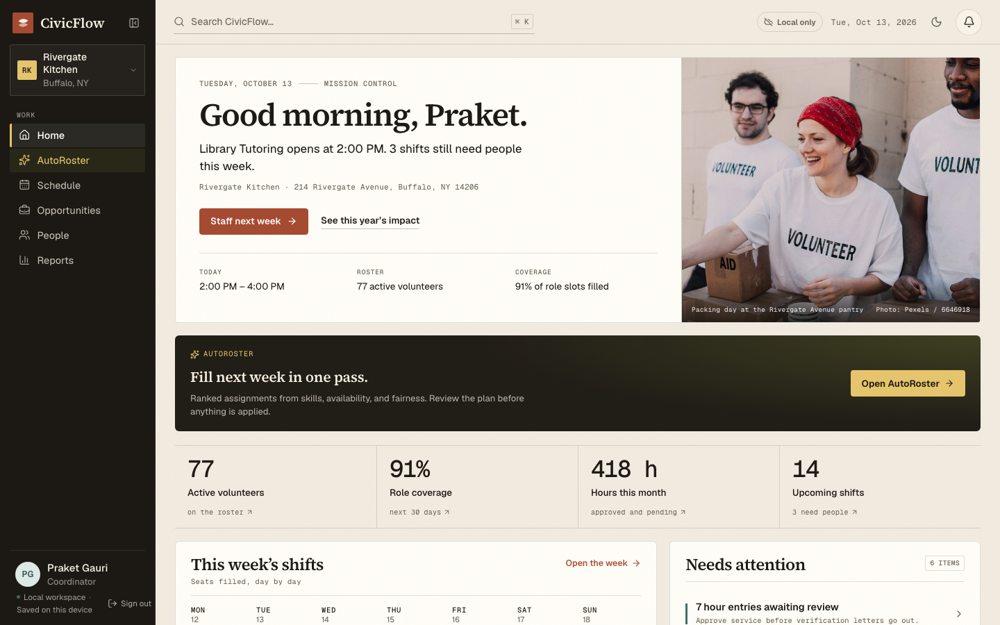
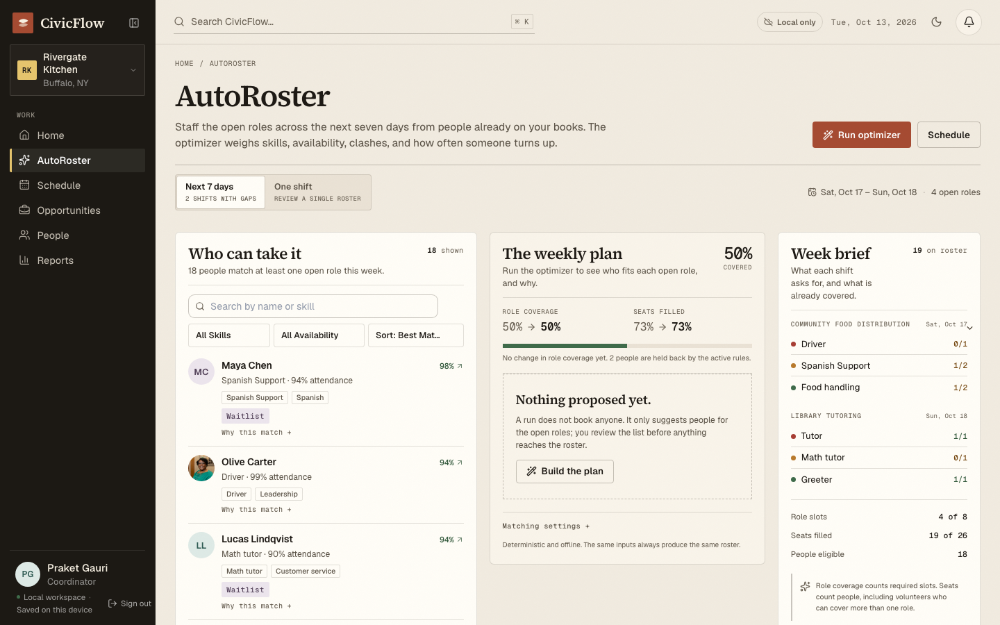
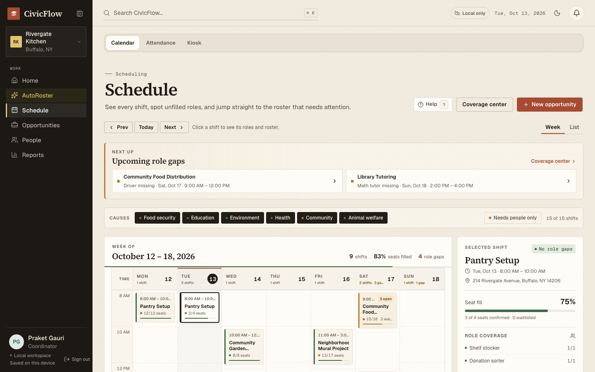
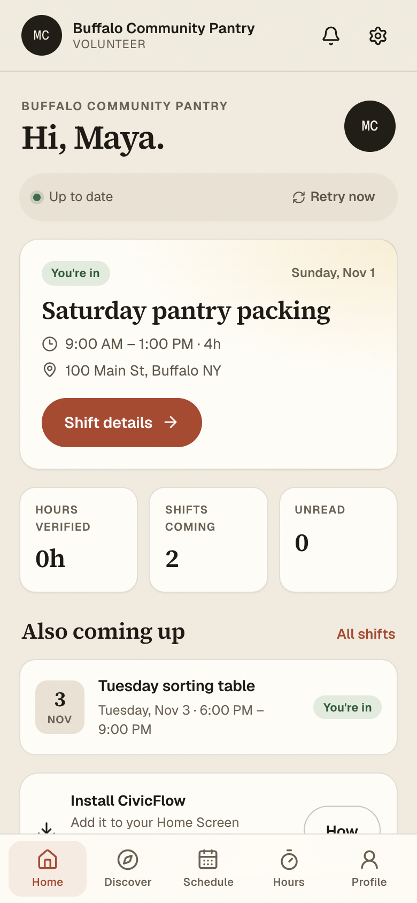
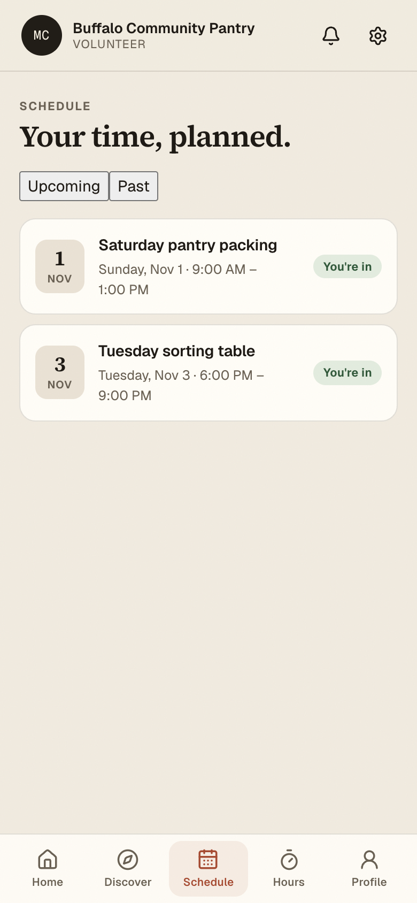

# CivicFlow

CivicFlow is a volunteer coordination platform for small nonprofits. Coordinators publish opportunities and shifts, staff open roles, track attendance and service hours, manage volunteer records, and report outcomes. Volunteers find service, register, check in, and keep a record of their contributions.

The desktop application is local-first: its workspace, scheduling, reporting, check-in, and AutoRoster features work without a network connection. An optional shared workspace connects the desktop and an installable volunteer PWA through Supabase for organizations that need multiple devices.

<!-- CIVICFLOW_FACTS_START -->
| Fact | Value |
| --- | --- |
| Package version | `0.1.1` |
| Registered routes | 57 |
| Migration files | 15 |
| Database schema | v15 |
| Application tables | 51 |
<!-- CIVICFLOW_FACTS_END -->

## Screenshots

| Coordinator home | AutoRoster |
| --- | --- |
|  |  |
| **Schedule** | **Volunteer home** |
|  |  |



## Core capabilities

- Opportunities, shifts, roles, weekly series, and capacity.
- Volunteer records, skills, availability, credentials, and applications.
- AutoRoster planning with an explanation for every assignment.
- Check-in, attendance, no-shows, and a check-in kiosk.
- Service-hour submission, review, approval, and records.
- Reports, CSV export, and a printable funder packet.
- An encrypted local SQLite workspace that works offline.
- An optional shared workspace and installable volunteer PWA.

## AutoRoster

AutoRoster assigns volunteers to open roles while respecting availability, conflicts, credentials, skills, age rules, rest requirements, and workload limits. It can fill one shift or review every upcoming gap.

The planner uses deterministic min-cost max-flow optimization. For every proposed assignment it reports the hard checks and score components, and it can compare an assigned volunteer with an eligible alternative.

## Architecture

```text
Desktop                                   Shared workspace
React 19 + TypeScript                     Volunteer PWA
        |                                        |
        v                                        v
Tauri 2 commands                          Supabase RPC
        |                                        |
        v                                        v
civicflow-core (Rust)                     Postgres
        |                                        |
        v                                        v
SQLite workspace                          change log + commands
```

- `src-tauri/core` owns the schema, migrations, authorization, workflow rules, matching, reporting, backups, and audit events. It has no Tauri dependency and is tested with `cargo test`.
- The desktop writes to local SQLite first. React reads one snapshot through the repository boundary; screens do not keep private copies of records.
- The shared workspace uses the server as the authority. Writes are queued locally, retried with stable operation IDs, and refused rather than silently merged when the server has newer data.
- The volunteer PWA and the desktop's shared view use the same Rust planner and the same synchronized data model.

## Development

Use the Node version in `.node-version`, pnpm 12.9.1, stable Rust, and the platform's Tauri prerequisites.

```bash
pnpm install --frozen-lockfile
pnpm dev              # browser preview at http://localhost:5173
pnpm tauri dev        # native desktop window
pnpm verify           # local quality gate
pnpm tauri build      # installers for this platform
```

The seeded demo workspace is available from the welcome screen and needs no account or network.

## Testing and quality

`pnpm verify` runs the TypeScript typecheck, ESLint, Prettier, generated-file checks, unit tests, SQL protocol tests, the web build, browser accessibility and print audits, Rust formatting, Clippy, and the Rust test suite.

CI additionally runs the macOS native end-to-end test with WebdriverIO, dependency audits in both Cargo workspaces, a production pnpm audit, and a gitleaks secret scan. The SQL suite applies every Supabase migration to PGlite and exercises row-level security, commands, sync, check-in, and reminders.

## Install and releases

Installers are built by `.github/workflows/release.yml` when a `v*` tag is pushed and published with a SHA-256 checksum file. The release workflow builds macOS on Apple silicon and Intel, Windows x64, and Linux x64.

macOS builds are ad-hoc signed unless Apple signing credentials are configured. Unsigned builds need **Open Anyway** in System Settings; unsigned Windows builds need **More info → Run anyway** if SmartScreen appears. Follow [`docs/RELEASE-CHECKLIST.md`](docs/RELEASE-CHECKLIST.md) for versioning, signing, and the clean-install matrix. The updater feed is published with the same tagged release.

## License and acknowledgements

CivicFlow is released under the [MIT License](LICENSE). The generated [third-party notices](THIRD_PARTY_NOTICES.md) list the direct dependencies and licenses. Bundled photography and fonts are credited in the in-app credits screen and in [`public/media/LICENSE.md`](public/media/LICENSE.md).
